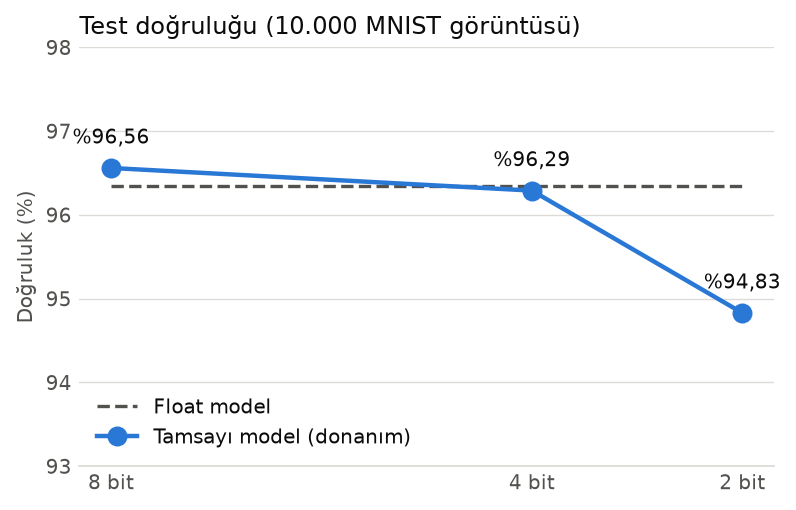
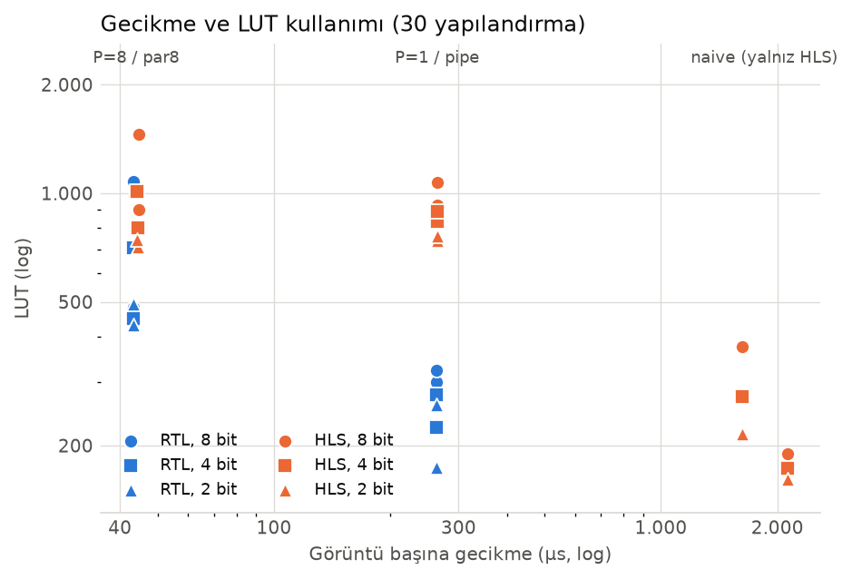
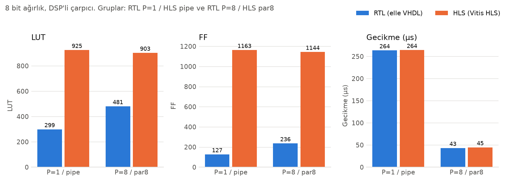
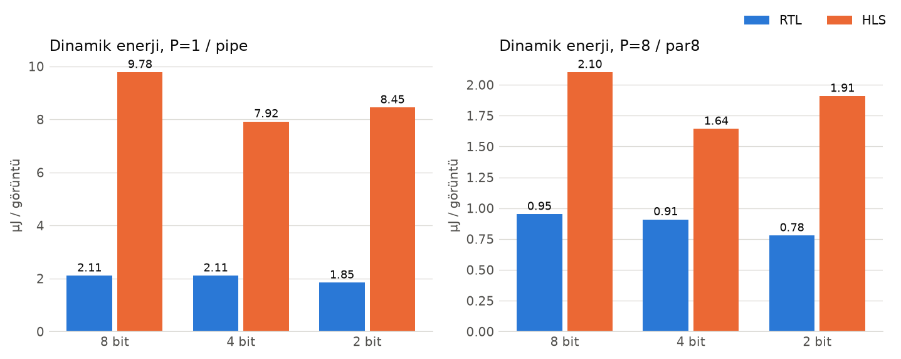
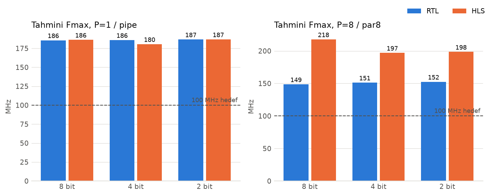

# MNIST Rakam Tanıma: FPGA'da RTL ve HLS Karşılaştırması

El yazısı rakam tanıyan küçük bir sinir ağı (784 → 32 → 10 MLP), Xilinx Artix-7 FPGA için iki
farklı yöntemle uygulanmış ve ölçülmüş sonuçlarla karşılaştırılmıştır:

- **RTL:** elle yazılmış VHDL
- **HLS:** Vitis HLS ile C++'tan üretilmiş donanım

Her iki uygulama da aynı tamsayı ağı çalıştırır ve Python'daki tamsayı referans modelle bit düzeyinde
aynı sonucu verir. Ağırlıklar 8, 4 ve 2 bit olarak quantize edilmiştir; donanımda kayan nokta
aritmetiği kullanılmaz.

| | |
|---|---|
| Hedef çip | Artix-7 `xc7a35tcpg236-1` (Basys3 / Arty A7-35T) |
| Saat hedefi | 100 MHz |
| Araçlar | Vivado 2023.2, Vitis HLS 2023.2, Python 3.11 (PyTorch, NumPy) |
| Doğrulama | Simülasyon ve Vivado implementasyon raporları (fiziksel kart kullanılmamıştır) |

## Öne çıkan sonuçlar

- **Doğruluk:** 8 bit %96,56, 4 bit %96,29, 2 bit %94,83. Ağırlıkları 8 bitten 2 bite indirmek
  doğruluğu yalnızca 1,7 puan düşürürken ağırlık belleğini dörtte birine indirir.
- **Bit düzeyinde doğrulama:** RTL simülasyonu 6 yapılandırmanın her birinde 10.000 test görüntüsünün
  tamamında referans modelle aynıdır; her görüntüde 32 gizli değer, 10 logit ve tahmin karşılaştırılır.
  HLS C simülasyonu 10.000 görüntüde, C/RTL co-simülasyonu 18 yapılandırmanın tamamında geçer.
- **RTL ve HLS:** Uygun pragmalarla HLS, elle yazılmış RTL ile neredeyse aynı gecikmeye (%1–3 fark)
  ulaşır; buna karşılık yaklaşık 2–3 kat LUT ve 5–9 kat FF kullanır.
- **Pragmaların etkisi:** Aynı C++ koduna eklenen birkaç pragma gecikmeyi 47 kat azaltır
  (212.737 → 4.473 çevrim).
- **Enerji:** görüntü başına dinamik enerji en düşük 0,39 µJ (RTL, P=8, 2 bit, LUT'lu çarpıcı), en yüksek
  44,7 µJ (HLS `naive`, 8 bit). Aynı gecikmedeki tasarımlarda HLS, RTL'in P=8 karşılığının 1,8–2,5 katı,
  P=1 karşılığının 3,8–4,6 katı dinamik enerji harcar (DSP'li çarpıcılar).
- **Maksimum frekans:** tahmini Fmax 136–250 MHz aralığındadır. P=1 / `pipe` düzeninde RTL ve HLS aynı
  frekansa (~186 MHz) çıkar; P=8 / `par8` düzeninde HLS (198–218 MHz) RTL'den (149–152 MHz) daha yüksektir.
- **Kod boyutu (8 bit, boş satır ve yorum hariç):** RTL kaynakları 381 satır, HLS kaynakları 89 satır.
- Bütün yapılandırmalar 100 MHz zamanlama hedefini karşılar.

### RTL ve HLS (8 bit ağırlık, DSP'li çarpıcılar)

| Uygulama | Çevrim / görüntü | LUT | FF | BRAM | DSP |
|---|---|---|---|---|---|
| RTL, P = 1 | 26.362 | 299 | 127 | 8,5 | 2 |
| HLS `pipe` | 26.437 | 925 | 1.163 | 9 | 3 |
| RTL, P = 8 | 4.326 | 481 | 236 | 8,5 | 9 |
| HLS `par8` | 4.473 | 903 | 1.144 | 9 | 9 |
| HLS `naive` | 212.737 | 190 | 259 | 9 | 3 |

## Grafikler

| | |
|---|---|
|  |  |







## Enerji ve maksimum frekans

Bütün 30 yapılandırma, 100 MHz'de. Güç değerleri Vivado'nun implementasyon sonrası güç raporundandır
(vektörsüz tahmin, bkz. Sınırlamalar). Enerji = güç × (çevrim / 100 MHz); "dinamik" sütunu statik güç
payını dışarıda bırakır. Fmax, aynı tasarımın 4 ns (250 MHz) saat kısıtıyla yeniden implemente edilip
`1 / (4 ns − WNS)` hesaplanmasıyla bulunan bir tahmindir.

| Uygulama | Bit | Varyant | Çarpıcı | Çevrim | Gecikme (µs) | Dinamik güç (mW) | Dinamik enerji (µJ) | Toplam enerji (µJ) | Fmax (MHz) |
|---|---|---|---|---|---|---|---|---|---|
| RTL | 8 | P=1 | DSP | 26.362 | 263,6 | 8 | 2,11 | 20,30 | 186 |
| RTL | 8 | P=1 | LUT | 26.362 | 263,6 | 9 | 2,37 | 20,30 | 136 |
| RTL | 8 | P=8 | DSP | 4.326 | 43,3 | 22 | 0,95 | 3,94 | 149 |
| RTL | 8 | P=8 | LUT | 4.326 | 43,3 | 17 | 0,73 | 3,72 | 137 |
| RTL | 4 | P=1 | DSP | 26.362 | 263,6 | 8 | 2,11 | 20,04 | 186 |
| RTL | 4 | P=1 | LUT | 26.362 | 263,6 | 6 | 1,58 | 19,51 | 150 |
| RTL | 4 | P=8 | DSP | 4.326 | 43,3 | 21 | 0,91 | 3,85 | 151 |
| RTL | 4 | P=8 | LUT | 4.326 | 43,3 | 10 | 0,43 | 3,42 | 144 |
| RTL | 2 | P=1 | DSP | 26.362 | 263,6 | 7 | 1,84 | 19,77 | 187 |
| RTL | 2 | P=1 | LUT | 26.362 | 263,6 | 3 | 0,79 | 18,98 | 197 |
| RTL | 2 | P=8 | DSP | 4.326 | 43,3 | 18 | 0,78 | 3,76 | 152 |
| RTL | 2 | P=8 | LUT | 4.326 | 43,3 | 9 | 0,39 | 3,37 | 150 |
| HLS | 8 | naive | DSP | 212.737 | 2.127,4 | 21 | 44,67 | 191,46 | 164 |
| HLS | 8 | naive | LUT | 162.241 | 1.622,4 | 24 | 38,94 | 150,88 | 184 |
| HLS | 8 | pipe | DSP | 26.437 | 264,4 | 37 | 9,78 | 28,02 | 186 |
| HLS | 8 | pipe | LUT | 26.428 | 264,3 | 39 | 10,31 | 28,28 | 170 |
| HLS | 8 | par8 | DSP | 4.473 | 44,7 | 47 | 2,10 | 5,19 | 218 |
| HLS | 8 | par8 | LUT | 4.468 | 44,7 | 52 | 2,32 | 5,41 | 170 |
| HLS | 4 | naive | DSP | 212.737 | 2.127,4 | 15 | 31,91 | 178,70 | 249 |
| HLS | 4 | naive | LUT | 162.241 | 1.622,4 | 15 | 24,34 | 134,66 | 218 |
| HLS | 4 | pipe | DSP | 26.405 | 264,1 | 30 | 7,92 | 26,14 | 180 |
| HLS | 4 | pipe | LUT | 26.396 | 264,0 | 28 | 7,39 | 25,60 | 165 |
| HLS | 4 | par8 | DSP | 4.441 | 44,4 | 37 | 1,64 | 4,71 | 197 |
| HLS | 4 | par8 | LUT | 4.436 | 44,4 | 34 | 1,51 | 4,57 | 167 |
| HLS | 2 | naive | DSP | 212.737 | 2.127,4 | 12 | 25,53 | 170,19 | 165 |
| HLS | 2 | naive | LUT | 162.241 | 1.622,4 | 10 | 16,22 | 128,17 | 238 |
| HLS | 2 | pipe | DSP | 26.404 | 264,0 | 32 | 8,45 | 26,40 | 187 |
| HLS | 2 | pipe | LUT | 26.395 | 263,9 | 30 | 7,92 | 25,87 | 185 |
| HLS | 2 | par8 | DSP | 4.440 | 44,4 | 43 | 1,91 | 4,93 | 198 |
| HLS | 2 | par8 | LUT | 4.435 | 44,4 | 34 | 1,51 | 4,57 | 174 |

Ham veri: [`results/energy.csv`](results/energy.csv), [`results/fmax.csv`](results/fmax.csv).

## Kod boyutu

8 bit tasarım, boş satırlar ve yorumlar hariç:

| | Kaynak | Testbench |
|---|---|---|
| RTL (VHDL) | 381 satır | 331 satır |
| HLS (C++) | 89 satır | 70 satır |

HLS kaynağındaki 89 satır üç varyantı (`naive`, `pipe`, `par8`) birlikte içerir. Geliştirme süresi ayrıca
kaydedilmemiştir.

## Model

- **Ağ:** 784 giriş (28×28 piksel) → 32 nöron (ReLU) → 10 çıkış
- **Eğitim:** PyTorch ile MNIST eğitim seti, ardından quantization'a duyarlı eğitim (QAT)
- **Sayı biçimi:** pikseller ve gizli aktivasyonlar 8 bit işaretsiz; ağırlıklar 8/4/2 bit işaretli
  (simetrik, 2 bitte {-1, 0, +1}); bias'lar 32 bit
- **Ölçekler:** tamamı 2'nin kuvveti; katmanlar arası yeniden ölçekleme yalnızca bit kaydırmadır.
  Ölçek üssü quantization hatasını (MSE) en aza indirecek şekilde seçilir.

Donanımın uyguladığı tamsayı hesap:

```
acc1[j]  = b1[j] + Σ x[i] · w1[j][i]
h[j]     = clamp((max(acc1[j], 0) + 2^(SH1-1)) >> SH1, 0, 255)
logit[k] = b2[k] + Σ h[j] · w2[k][j]
tahmin   = argmax(logit)            (eşitlikte en küçük indeks)
```

| Ağırlık | Float model | Tamsayı model (= donanım) |
|---|---|---|
| 8 bit | %96,35 | %96,56 |
| 4 bit | %96,35 | %96,29 |
| 2 bit | %96,35 | %94,83 |

## RTL tasarımı

```
piksel akışı (AXI-Stream) → giriş tamponu (784 × 8 bit)
                               │
              ┌────────────────┼────────────────┐
           ROM₀ + MAC₀      ROM₁ + MAC₁  ...  ROM_(P-1) + MAC_(P-1)   1. katman, P nöron paralel
              └────────────────┼────────────────┘
                     requant (ReLU, >> SH1, 0–255)
                               │
                    gizli tampon (32 × 8 bit)
                               │
                ROM + MAC (2. katman) → argmax → tahmin (0–9)
```

| Dosya | İçerik |
|---|---|
| `mnist_pkg.vhd` | sabitler, `requant` fonksiyonu, bias dosyası okuma |
| `weight_rom.vhd` | blok RAM'de ağırlık ROM'u; içerik elaborasyonda `.mem` dosyasından yüklenir |
| `mnist_mlp.vhd` | çekirdek: giriş tamponu, durum makinesi, P paralel çarp-topla, 2. katman, argmax |
| `mnist_mlp_top.vhd` | sentez için üst modül |

Generic'ler: `W_BITS` (8/4/2), `P` (1. katmandaki paralel nöron sayısı, 32'yi bölmeli), `USE_DSP`
(çarpıcılar DSP48'de veya LUT'ta), `SH1`, `ACC1_BITS`, `ACC2_BITS` (değerleri `mem/params.json`
dosyasındadır). Çarp-topla birimi iki aşamalı boru hattıdır.

Gecikme: P = 1 için 26.362, P = 8 için 4.326 çevrim/görüntü (100 MHz'de 264 µs ve 43 µs).

| W_BITS | P | Çarpıcı | Çevrim | LUT | FF | BRAM | DSP | WNS (ns) | Güç* (W) |
|---|---|---|---|---|---|---|---|---|---|
| 8 | 1 | DSP | 26.362 | 299 | 127 | 8,5 | 2 | +3,49 | 0,077 |
| 8 | 1 | LUT | 26.362 | 324 | 181 | 9 | 0 | +1,19 | 0,077 |
| 8 | 8 | DSP | 4.326 | 481 | 236 | 8,5 | 9 | +2,04 | 0,091 |
| 8 | 8 | LUT | 4.326 | 1.075 | 479 | 9 | 0 | +0,93 | 0,086 |
| 4 | 1 | DSP | 26.362 | 277 | 118 | 4,5 | 2 | +3,74 | 0,076 |
| 4 | 1 | LUT | 26.362 | 224 | 161 | 5 | 0 | +2,33 | 0,074 |
| 4 | 8 | DSP | 4.326 | 449 | 220 | 4,5 | 9 | +1,75 | 0,089 |
| 4 | 8 | LUT | 4.326 | 706 | 403 | 5 | 0 | +0,97 | 0,079 |
| 2 | 1 | DSP | 26.362 | 260 | 111 | 2,5 | 2 | +3,69 | 0,075 |
| 2 | 1 | LUT | 26.362 | 174 | 146 | 3 | 0 | +3,84 | 0,072 |
| 2 | 8 | DSP | 4.326 | 431 | 206 | 4,5 | 9 | +2,48 | 0,087 |
| 2 | 8 | LUT | 4.326 | 494 | 346 | 5 | 0 | +3,08 | 0,078 |

## HLS tasarımı

`hls/mnist_wN/src/mnist_hls.cpp`, RTL tasarımıyla aynı hesabı yapar. Arayüz: pikseller için
AXI-Stream (`axis`), tahmin için `ap_vld`, blok kontrol `ap_ctrl_hs`. Optimizasyon pragmaları
`VARIANT` makrosuyla seçilir; kodun geri kalanı üç varyantta aynıdır.

| Varyant | Pragmalar | RTL karşılığı |
|---|---|---|
| `naive` | yok (otomatik boru hattı da kapalı) | — |
| `pipe` | en içteki döngüler `PIPELINE II=1` | P = 1 |
| `par8` | piksel döngüsü `PIPELINE II=1`, `W1` dizisi `ARRAY_PARTITION cyclic factor=8` | P = 8 |

Her varyantın iki solution'ı vardır: `dsp` ve `lut` (`config_op mul -impl dsp|fabric`). HLS'in ürettiği
RTL, RTL tasarımıyla aynı Vivado akışından (out-of-context, 100 MHz) geçirilmiştir. Çevrim sayıları
C/RTL co-simülasyonundan alınmıştır.

| W_BITS | Varyant | Çarpıcı | Çevrim | LUT | FF | BRAM | DSP | WNS (ns) | Güç* (W) |
|---|---|---|---|---|---|---|---|---|---|
| 8 | naive | DSP | 212.737 | 190 | 259 | 9 | 3 | +4,71 | 0,090 |
| 8 | naive | LUT | 162.241 | 376 | 328 | 9 | 0 | +2,08 | 0,093 |
| 8 | pipe | DSP | 26.437 | 925 | 1.163 | 9 | 3 | +3,12 | 0,106 |
| 8 | pipe | LUT | 26.428 | 1.072 | 1.221 | 9 | 0 | +1,70 | 0,107 |
| 8 | par8 | DSP | 4.473 | 903 | 1.144 | 9 | 9 | +2,70 | 0,116 |
| 8 | par8 | LUT | 4.468 | 1.455 | 1.295 | 9 | 0 | +1,29 | 0,121 |
| 4 | naive | DSP | 212.737 | 173 | 242 | 5 | 3 | +5,20 | 0,084 |
| 4 | naive | LUT | 162.241 | 273 | 300 | 5 | 0 | +3,38 | 0,083 |
| 4 | pipe | DSP | 26.405 | 837 | 999 | 5 | 3 | +3,07 | 0,099 |
| 4 | pipe | LUT | 26.396 | 892 | 1.045 | 5 | 0 | +1,38 | 0,097 |
| 4 | par8 | DSP | 4.441 | 800 | 978 | 5 | 9 | +3,26 | 0,106 |
| 4 | par8 | LUT | 4.436 | 1.013 | 1.091 | 5 | 0 | +1,74 | 0,103 |
| 2 | naive | DSP | 212.737 | 161 | 231 | 3 | 3 | +4,76 | 0,080 |
| 2 | naive | LUT | 162.241 | 216 | 283 | 3 | 0 | +5,25 | 0,079 |
| 2 | pipe | DSP | 26.404 | 738 | 883 | 3 | 3 | +3,42 | 0,100 |
| 2 | pipe | LUT | 26.395 | 761 | 919 | 3 | 0 | +2,16 | 0,098 |
| 2 | par8 | DSP | 4.440 | 709 | 858 | 5 | 9 | +3,10 | 0,111 |
| 2 | par8 | LUT | 4.435 | 742 | 950 | 5 | 0 | +1,50 | 0,103 |

\* Güç değerleri Vivado'nun vektörsüz tahminidir, donanım üzerinde ölçülmemiştir. Bu boyuttaki
tasarımlarda toplamın büyük bölümü çipin statik gücüdür (~0,07 W).

HLS sentez raporundaki zamanlama tahmini, varsayılan %27'lik saat belirsizliği nedeniyle 7,3 ns'lik bir
iç hedefe göre hesaplanır ve bazı yapılandırmalarda "Timing Violation" uyarısı gösterir. Tablodaki WNS
değerleri yerleştirme ve yönlendirme sonrası gerçek zamanlamadır; tamamı 10 ns hedefini karşılar.

## Klasör yapısı

```
model/                      Python: eğitim, quantization, tamsayı referans model, testler
rtl/mnist_w8/               RTL projesi, 8 bit ağırlık
    mnist_w8.xpr            Vivado projesi
    src/                    VHDL kaynakları
    sim/                    testbench'ler (fixtures/: birim test verileri)
    constrs/                zamanlama kısıtı (100 MHz)
    mem/                    ağırlıklar (.mem), params.json, test görüntüleri, beklenen çıktılar
rtl/mnist_w4/, rtl/mnist_w2/
hls/mnist_w8/               HLS projeleri, 8 bit ağırlık
    src/                    mnist_hls.cpp, mnist_hls.h, weights_hls.h
    tb/                     C testbench
    data/                   test görüntüleri, beklenen tahminler
    naive/  pipe/  par8/    Vitis HLS projeleri (solution'lar: dsp, lut)
    vivado/                 HLS'in ürettiği RTL (par8, dsp) ve Vivado projesi
hls/mnist_w4/, hls/mnist_w2/
results/                    ölçüm sonuçları (CSV) ve Vivado raporları
scripts/                    komut satırı simülasyon, implementasyon ve proje oluşturma scriptleri
```

Her bit genişliği klasörü bağımsızdır; kendi kaynaklarını, verisini ve projesini içerir. VHDL ve C++
kaynakları üç bit genişliğinde aynıdır, fark ağırlık dosyalarında ve parametrelerdedir.

## Projeleri açmak

**RTL (Vivado 2023.2):** `rtl/mnist_w8/mnist_w8.xpr` (Windows'ta çift tıklama yeterlidir).

- *Run Simulation → Run Behavioral Simulation*: `tb_mnist_mlp` ilk 20 test görüntüsünü çalıştırır ve
  sonuçları referans modelle karşılaştırır. Tcl konsolu çıktısı:
  `SONUC: mismatch=0 correct=19/20 cycles=4326.0` ve `TEST GECTI`.
- *Run Synthesis / Run Implementation*: varsayılan yapılandırma `P=8`, `USE_DSP=true`
  (*Settings → General → Generics*).

**HLS (Vitis HLS 2023.2):** *File → Open Project* ile `hls/mnist_w8/par8` klasörü (veya `naive`, `pipe`).

- *C Simulation*: varsayılan olarak 20 görüntü; *Input Arguments* alanına `0` yazıldığında tüm
  görüntüler çalışır. Çıktı: `SONUC: mismatch=0 correct=.../...` ve `TEST GECTI`.
- *C Synthesis* ve *Co-Simulation*: gecikme ve kaynak raporları, dalga formları.
- HLS'in ürettiği RTL'in Vivado projesi: `hls/mnist_w8/vivado/mnist_hls_w8.xpr`.

## Sonuçları yeniden üretmek

```bash
pip install -r model/requirements.txt

# Python testleri
cd model && python -m pytest && cd ..

# Modeli eğitip proje dosyalarını yeniden üretmek (rtl/*/mem, hls/*/src, hls/*/data)
python model/train.py --bits 8 4 2 --epochs 10 --qat-epochs 5

# Eğitim yapmadan: 10.000 görüntülük test seti (data/test) ve beklenen çıktılar
python model/make_test_vectors.py

# RTL: tek simülasyon, 10.000 görüntülük regresyon, 12 implementasyon
python scripts/run_sim.py tb_mnist_mlp --bits 8 -g P=8 -g N_IMAGES=100
python scripts/run_impl.py --sim
python scripts/run_impl.py --all

# HLS: 10.000 görüntülük C simülasyonu, 18 yapılandırma (sentez, co-simülasyon, implementasyon)
python scripts/run_hls.py --csim
python scripts/run_hls.py --all

# Fmax tahmini (30 yapılandırma, 4 ns kısıtla yeniden implementasyon) ve enerji tablosu + grafikler
python scripts/run_fmax.py
python scripts/make_report.py
```

Scriptler Vivado'yu `C:/Xilinx/Vivado/2023.2/bin`, Vitis HLS'i `C:/Xilinx/Vitis_HLS/2023.2/bin` altında
arar; farklı kurulumlar için `VIVADO_BIN` ve `VITIS_HLS_BIN` ortam değişkenleri kullanılabilir.
Projeleri sıfırdan oluşturmak için `scripts/create_rtl_projects.tcl`, `scripts/create_hls_projects.tcl`
ve `scripts/create_hls_vivado_projects.tcl` kullanılır.

## Sınırlamalar

- Tasarımlar fiziksel bir kartta çalıştırılmamıştır; doğrulama simülasyonla, kaynak ve zamanlama
  değerleri Vivado implementasyonuyla elde edilmiştir.
- Tasarımlar out-of-context olarak implemente edilmiştir (pin ataması yoktur). Karta yüklemek için
  görüntü girişi (ör. UART) ve sonuç çıkışı (ör. 7 segment gösterge) içeren bir üst modül gerekir.
- Güç değerleri Vivado'nun vektörsüz tahminidir (rapordaki güven düzeyi "Medium"); gerçek çalışma
  aktivitesiyle (SAIF) ya da kartta ölçülmemiştir. Bu boyuttaki tasarımlarda toplam gücün yaklaşık
  dörtte üçü çipin statik gücüdür; bu yüzden karşılaştırmada dinamik güç ve enerji esas alınmıştır.
- Fmax değerleri tahmindir: aynı tasarım 4 ns kısıtıyla bir kez implemente edilmiş, en yüksek frekans
  kalan setup payından hesaplanmıştır. Saat darbesi genişliği gibi sınırlar hesaba katılmamıştır.
